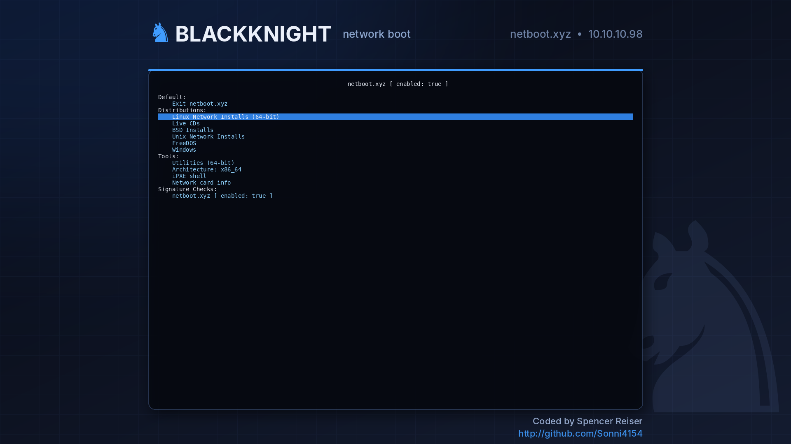

# Boot menu branding

Graphical theme for the netboot.xyz menu: a background picture at 1920x1080 (falls back to
1024x768, then to the plain text menu), with the normal netboot.xyz menu drawn inside the panel.

No iPXE rebuild is needed: netboot.xyz's boot loaders are built with `CONSOLE_FRAMEBUFFER`,
`CONSOLE_CMD` and `IMAGE_PNG`.

## How it hooks in
On TFTP boots the netboot.xyz loader chains `local-vars.ipxe` before `menu.ipxe`. The installer
appends one line to `local-vars.ipxe` (in `config/menus/` and `config/menus/local/`, the copy that
survives menu updates from the admin UI):

    chain --autofree branding.ipxe || echo Branding not loaded, continuing in text mode

`branding.ipxe` switches to the graphical console with `console --picture`, loading the PNGs from
the asset mirror at `http://10.10.10.98:8080/branding/`. Background colour 9 is transparent, so the
picture shows through the text.

## Install / undo
Run on blackknight (finds the container's `/config` and `/assets` volumes with `docker inspect`,
backs up `local-vars.ipxe` as `*.bak-<timestamp>`, no container restart):

    sudo bash branding/install-branding.sh
    sudo bash branding/install-branding.sh --uninstall

Override the picture URL with `ASSET_URL=... ` if the LAN IP or asset port changes.

## Editing the pictures
`make_bg.py` draws both PNGs (needs Pillow, Inter and DejaVu fonts):

    python3 branding/make_bg.py branding/

Text margins in `branding.ipxe` must match the panel position in `make_bg.py`.
